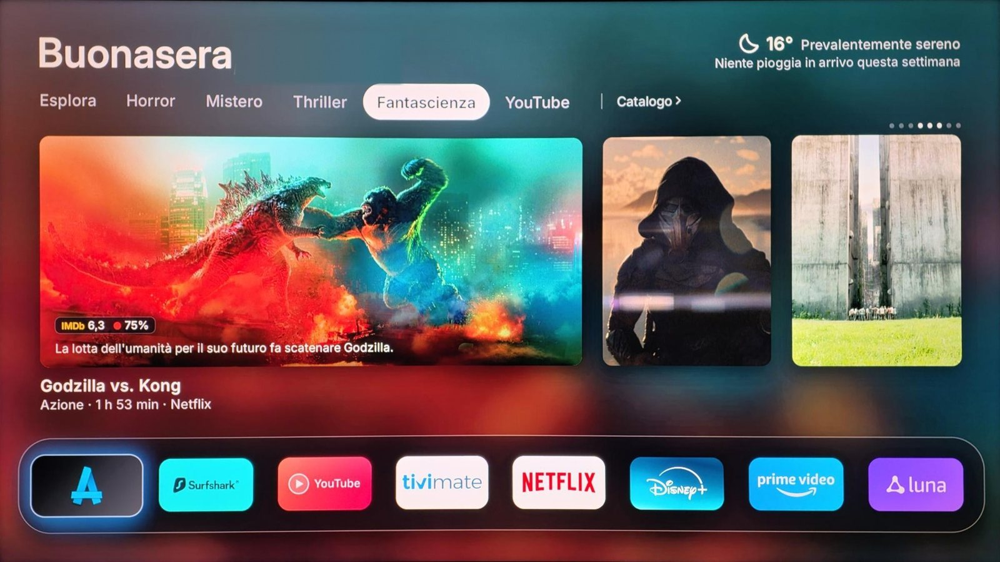
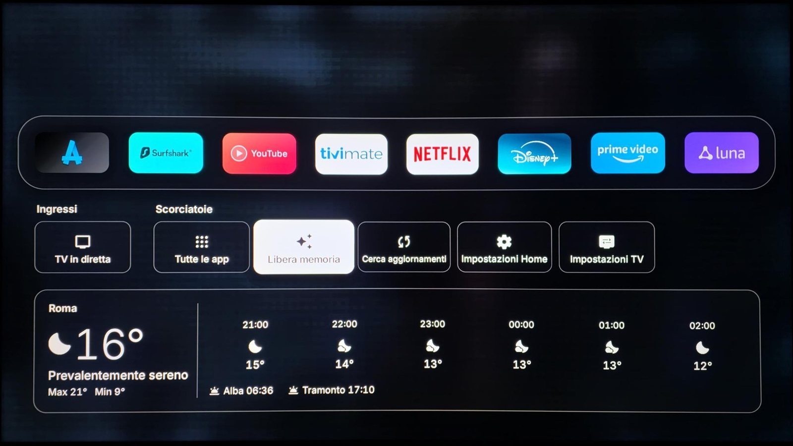
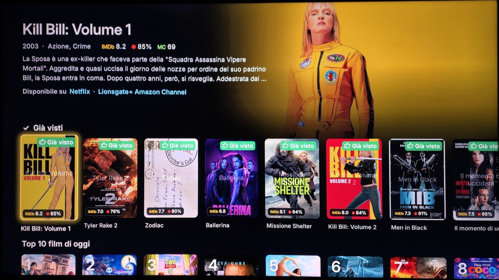
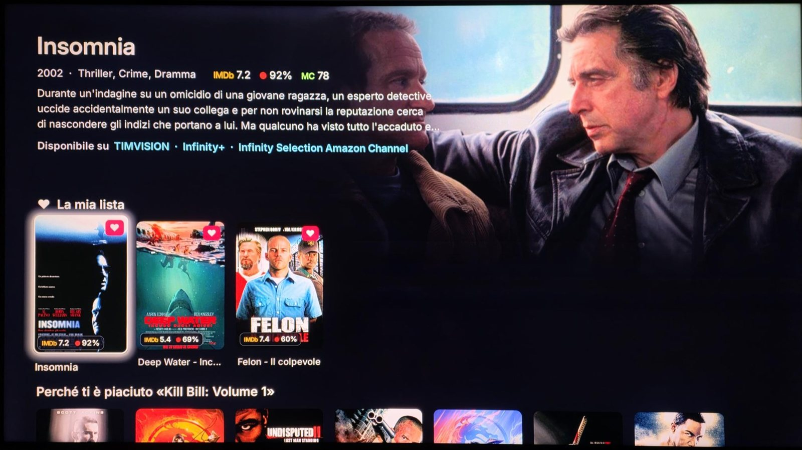
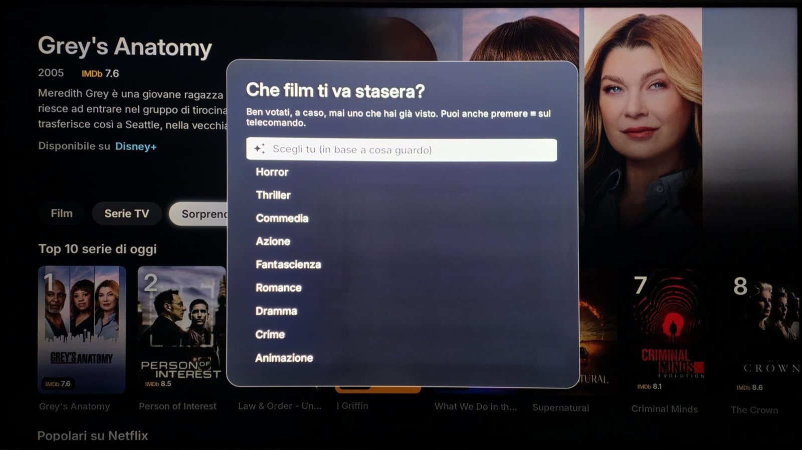
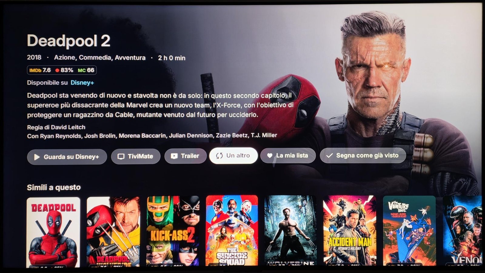

# Nottilo

**A free launcher for Fire TV and Android TV.** A clean home screen with your apps, movie and series picks from the services you have, a catalog by genre, and the weather. No ads, no sign-up, no data collected.

<p align="center"></p>

<p align="center">
  <a href="https://github.com/vuoshino/Nottilo/raw/main/download/Nottilo.apk"></a>
  <a href="https://ko-fi.com/nottilo"></a>
  <a href="https://github.com/vuoshino/Nottilo/issues/new/choose"></a>
</p>

<p align="center"><b>Fire TV: open the <i>Downloader</i> app and type <code>4702696</code></b></p>

<p align="center"><b>Nottilo is free and made by one person. If you like it, <a href="https://ko-fi.com/nottilo">support it on Ko‑fi</a> ☕ — every coffee goes into new features.</b><br>
<a href="#italiano">Italiano</a> · <a href="#contribute">How to contribute</a></p>

---

## Features

- **Replaces the Fire TV home screen — with a single command, once.** The Home button opens Nottilo, no root, nothing uninstalled, and one option brings Amazon's home back. [How ↓](#make-nottilo-your-home-button)
- **Picks for tonight** — movies and series from the streaming services available in your country, with poster, plot, length and where to watch.
- **Tabs by mood** — Horror, Mystery, Thriller, Sci‑Fi, plus a YouTube tab with the latest videos of your channels.
- **Catalog by genre** — every title of your services in rows: select *Catalog ›* next to the tabs (or press ≡ on a Fire TV remote). Inside, *"What should I watch tonight?"* picks one for you (≡ on Fire TV rerolls it).
- **Hold OK to mark, rate and save** — learns your taste:
  - **On the home screen:** hold OK on a pick → a menu with *Watched* or *Add to list*.
  - **In the catalog:** hold OK on any poster → it's marked *watched* at once (hold again to undo). Press OK to open it and add it to *My list*.
  - After *Watched* it asks **"Did you like it?"** 👍 / 👎, and the next picks follow your answer.
- **My list and Continue watching.**
- **Scores** — IMDb and Rotten Tomatoes (optional OMDb key).
- **Opens titles straight in their app** — Netflix, Prime Video, Disney+… (optional Watchmode key).
- **A greeting that follows your day** — *Good morning*, *Good afternoon*, *Good evening* or *Good night*, with your name.
- **Your city's weather at a glance** — the temperature and sky now, and whether rain is coming today or in the next days (or "no rain this week"). Down in the drawer: hourly forecast, max/min, sunrise and sunset. The city is found from the TV's time zone; the language follows the TV.
- **Set up from your phone** — scan the QR code on the TV, paste your keys, done. Each key is tested on the spot (✓ / ✗).
- **Free memory in one press** — the *Free memory* shortcut closes the apps left running in the background, so the stick stays fast.
- **Backup** — save your list, watched titles and settings as a file on your phone, or automatically on your own Google Drive.
- **Smooth** — 60 fps animations, made for the remote.

## Screenshots

| | |
| --- | --- |
|  |  |
| **Home** — picks for tonight, weather, your apps | **Drawer** — inputs, Free memory, updates, hourly weather |
|  |  |
| **Catalog** — scores, where to watch, watched titles | **My list** and picks based on what you liked |
|  |  |
| **"What should I watch tonight?"** | **Title page** — watch, trailer, another one, my list |

## Requirements

- Amazon Fire TV Stick / Cube (Fire OS 7 or 8), or an Android TV / Google TV with Android 8 or newer.
- A free [TMDB](https://www.themoviedb.org/signup) account for the API key (5 minutes; the app walks you through it).

## Install

1. **Developer options:** Settings → My Fire TV → About → press OK on the device name 7 times.
   *(Android TV: Settings → System → About → press* Build *7 times.)*
2. In **Developer options**, turn on **ADB debugging** and allow **unknown apps** for *Downloader*.
3. Open **Downloader** and type the code **`4702696`**
   (or the full link: `https://github.com/vuoshino/Nottilo/raw/main/download/Nottilo.apk`).
4. Open Nottilo: the welcome screen shows a **QR code**. Scan it with your phone and paste your TMDB key.
5. **Home button:** Settings → *Home Screen* → *Nottilo*.
   - *Android TV / Google TV:* accept "Allow USB debugging?" (tick *Always allow*).
   - *Fire TV:* Amazon doesn't let apps do this by themselves, so Nottilo shows **one command** to send once from a computer (`adb`) or an Android phone (an app like *Remote ADB Shell*), with your TV's address already filled in. From then on the Home button opens Nottilo.
6. To go back: Settings → *Home Screen* → *Original*. Nothing is uninstalled, no root needed.

## Make Nottilo your Home button

**Android TV / Google TV:** Nottilo → Settings → *Home Screen* → *Nottilo*, accept "Allow USB debugging?" (tick *Always allow*). Done.

**Fire TV:** Amazon blocks apps from doing it by themselves, so it takes **one command, sent once**. Nottilo shows it on screen with your TV's IP already filled in (Settings → *Home Screen* → *Nottilo*):

```
adb connect YOUR-TV-IP:5555
adb shell pm grant app.nottilo.launcher android.permission.WRITE_SECURE_SETTINGS
```

- **From a computer:** install [Android platform-tools](https://developer.android.com/tools/releases/platform-tools) and run the two lines above.
- **From an Android phone, no computer:** install an ADB app such as *Remote ADB Shell*, connect to `YOUR-TV-IP:5555`, accept the prompt on the TV, then type `pm grant app.nottilo.launcher android.permission.WRITE_SECURE_SETTINGS`.

The moment the command arrives, Nottilo takes over the Home button by itself, and it stays that way after restarts and updates. Keep *ADB debugging* on. To go back: Settings → *Home Screen* → *Original*.

## Updating

**Just press *Check for updates*:** scroll down below your apps to open the drawer, select **Check for updates** and confirm. That's all — no need to download anything again. Nottilo also checks by itself every few hours and asks before installing. Current version: see [download/latest.json](download/latest.json).

## Known issues

- **Fire OS 7** (older Fire TV Sticks): Amazon delays apps by a few seconds after the Home button, so Amazon's home may show briefly before Nottilo. Fire OS 8 and Android TV are not affected.
- Languages: English and Italian are complete; in other languages some newer texts are still in English.

## Privacy

Your keys, name and city stay **on your TV only**. Nottilo has no server and collects nothing. It talks only to the services you give a key to (TMDB, OMDb, Watchmode, YouTube), to Open‑Meteo for the weather, and to GitHub for updates.

## Contribute

Nottilo grows with the people who use it. Three ways to help:

| | |
| --- | --- |
| ☕ **[Support it on Ko‑fi](https://ko-fi.com/nottilo)** | A coffee keeps updates coming. No account needed, PayPal or card. |
| 💡 **[Suggest an idea or report a bug](https://github.com/vuoshino/Nottilo/issues/new/choose)** | Tell what you'd like or what doesn't work: every report makes it better. |
| ⭐ **Star this page** | It helps other people find Nottilo. |

---

## Italiano

**Un launcher gratuito per Fire TV e Android TV.** Una Home pulita con le tue app, consigli di film e serie dai servizi che hai, catalogo per genere e meteo. Niente pubblicità, nessuna registrazione, nessun dato raccolto.

**Su Fire TV: apri Downloader e scrivi `4702696`** · **[⬇ Scarica Nottilo.apk](https://github.com/vuoshino/Nottilo/raw/main/download/Nottilo.apk)** · **[☕ Sostienilo su Ko‑fi](https://ko-fi.com/nottilo)** · **[💡 Idee e segnalazioni](https://github.com/vuoshino/Nottilo/issues/new/choose)**

**Cosa fa**
- **Sostituisce la Home della Fire TV con un solo comando, da dare una volta.** Il tasto Home apre Nottilo: niente root, non si disinstalla nulla, e un'opzione riporta la Home di Amazon.
- Consigli per stasera dai servizi di streaming del tuo paese, con locandina, trama, durata e dove guardarli.
- Schede Horror, Mistero, Thriller, Fantascienza e YouTube (gli ultimi video dei tuoi canali, anche senza chiave).
- Catalogo per genere: premi OK su *Catalogo ›* accanto alle schede (sul telecomando Fire TV basta il tasto ≡). Dentro, *"Che film ti va stasera?"* ne sceglie uno per te (≡ su Fire TV ne propone un altro).
- **Tieni premuto OK per segnare, votare e salvare:**
  - **in Home**, su un consiglio: menu con *Già visto* o *Aggiungi alla lista*;
  - **nel Catalogo**, su qualsiasi locandina: lo segna subito come *già visto* (tieni premuto di nuovo per annullare); con OK lo apri e lo aggiungi a *La mia lista*;
  - dopo *Già visto* ti chiede **"Ti è piaciuto?"** 👍 / 👎 e i consigli si adattano ai tuoi gusti.
- La mia lista, Continua a guardare, voti IMDb e Rotten Tomatoes, apertura diretta nell'app giusta.
- **Saluto che segue la giornata:** *Buongiorno*, *Buon pomeriggio*, *Buonasera* o *Buonanotte*, con il tuo nome.
- **Meteo della tua città a colpo d'occhio:** temperatura e cielo di adesso, e se pioverà oggi o nei prossimi giorni (oppure "niente pioggia questa settimana"). Nel cassetto: previsioni ora per ora, massima/minima, alba e tramonto. La lingua segue quella del televisore.
- Configurazione dal telefono con un codice QR; ogni chiave viene provata subito.
- **Libera memoria con un tasto:** la scorciatoia *Libera memoria* chiude le app rimaste aperte in background, così la chiavetta resta veloce.
- Backup come file sul telefono o automatico sul tuo Google Drive.

**Installazione:** Opzioni sviluppatore → *Debug ADB* attivo e origini sconosciute per *Downloader* → in Downloader scrivi il codice **`4702696`** → apri Nottilo e inquadra il QR. 

**Nottilo come Home (tasto Home)**
- *Android TV / Google TV:* Impostazioni → *Schermata Home* → *Nottilo* e accetta il debug USB. Fatto.
- *Fire TV:* serve **un solo comando, una volta sola**. Nottilo te lo mostra già pronto con l'IP del tuo TV (Impostazioni → *Schermata Home* → *Nottilo*):
  ```
  adb connect IP-DEL-TV:5555
  adb shell pm grant app.nottilo.launcher android.permission.WRITE_SECURE_SETTINGS
  ```
  Da computer con gli [Android platform-tools](https://developer.android.com/tools/releases/platform-tools), oppure da telefono Android con un'app ADB come *Remote ADB Shell* (lì scrivi solo la riga `pm grant …`). Appena il comando arriva, Nottilo prende il tasto Home da solo e lo mantiene anche dopo riavvii e aggiornamenti. Tieni attivo il *Debug ADB*.

**Limiti noti:** su Fire OS 7 (Fire TV Stick più vecchie) Amazon ritarda le app di qualche secondo dopo il tasto Home, quindi può comparire per un attimo la Home di Amazon. Su Fire OS 8 e Android TV non succede.

**Aggiornare:** basta premere **Cerca aggiornamenti**. Scendi sotto le tue app per aprire il cassetto, scegli *Cerca aggiornamenti* e conferma: non serve riscaricare nulla. Nottilo controlla anche da solo ogni poche ore e chiede prima di installare.

**Privacy:** chiavi, nome e città restano solo sul televisore. Nottilo non ha server e non raccoglie nulla.

**Contribuisci al progetto**
- ☕ **[Sostienilo su Ko‑fi](https://ko-fi.com/nottilo)**: Nottilo è gratuito e fatto da una persona sola, ogni caffè diventa nuove funzioni. Senza account, con PayPal o carta.
- 💡 **[Proponi un'idea o segnala un problema](https://github.com/vuoshino/Nottilo/issues/new/choose)**: ogni segnalazione lo migliora.
- ⭐ Metti una **stella** a questa pagina: aiuta altre persone a trovarlo.

---

## Credits

- Built on [Free My TV](https://github.com/simbasjungles/free-my-tv) © Free My TV contributors, MIT License — see [THIRD-PARTY-NOTICES.md](THIRD-PARTY-NOTICES.md).
- This product uses the TMDB API but is not endorsed or certified by TMDB.
- Scores from OMDb; streaming links from TMDB and Watchmode (each with your own key, under its own terms); weather from Open‑Meteo.
- QR codes: [QR Code generator](https://www.nayuki.io/page/qr-code-generator-library) by Project Nayuki (MIT). Icons: Material Symbols (Apache 2.0). Font: Inter (SIL OFL 1.1).
- Netflix, Prime Video, Disney+, YouTube, Fire TV and other names belong to their owners. Nottilo is not affiliated with them.

Nottilo is free to download and use. © Nottilo. The app may not be resold or redistributed under another name.
